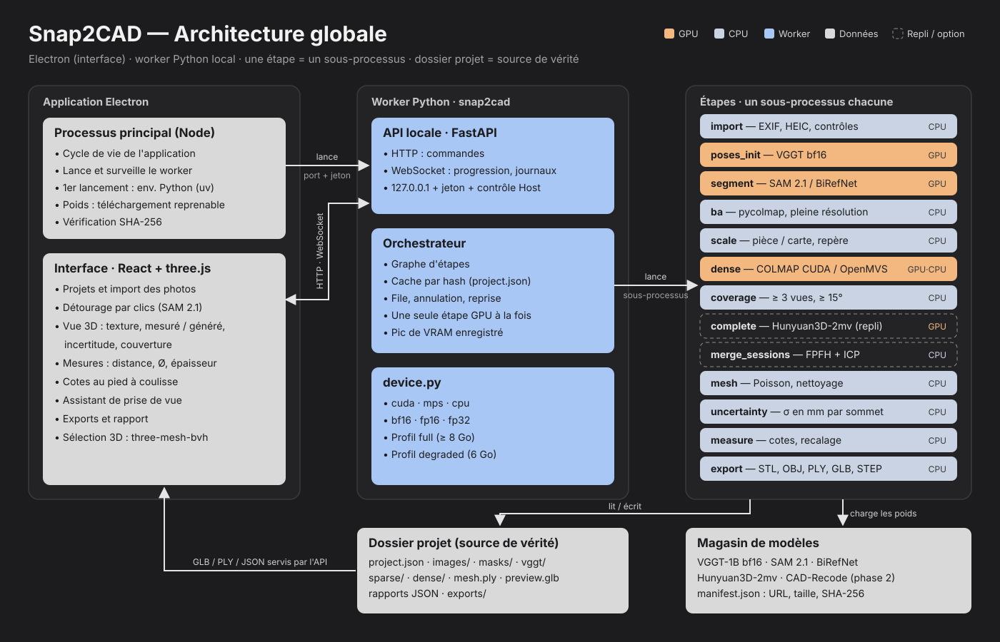
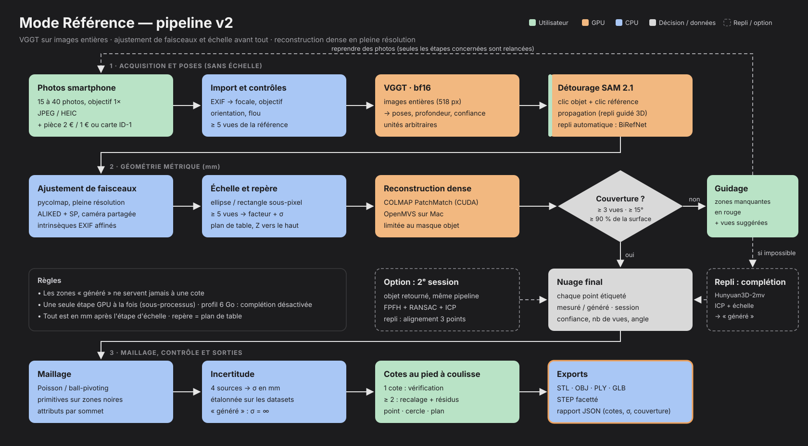
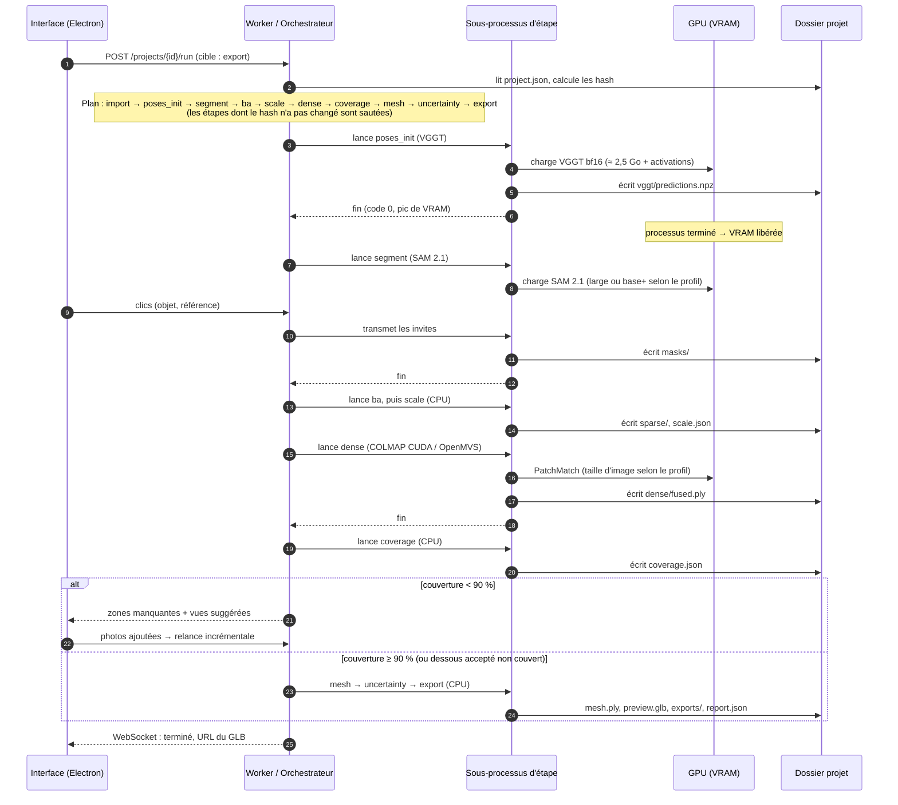
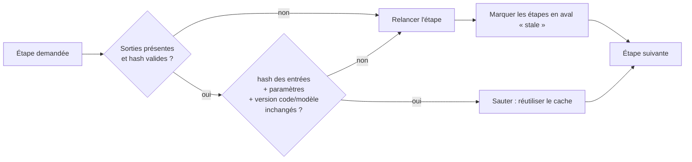
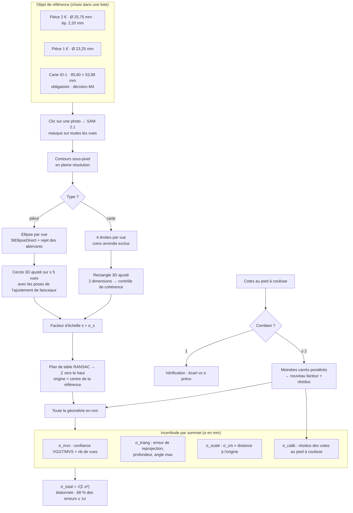
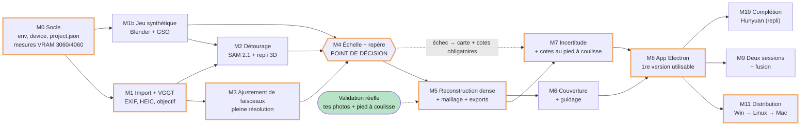
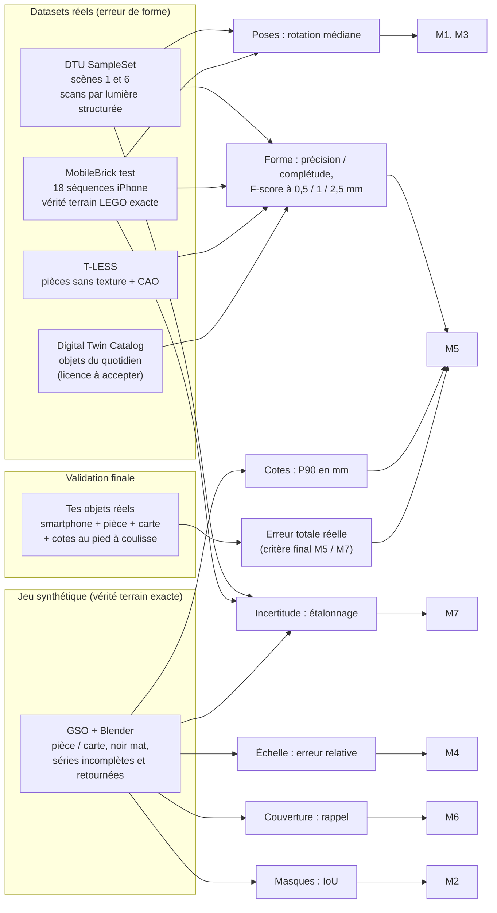
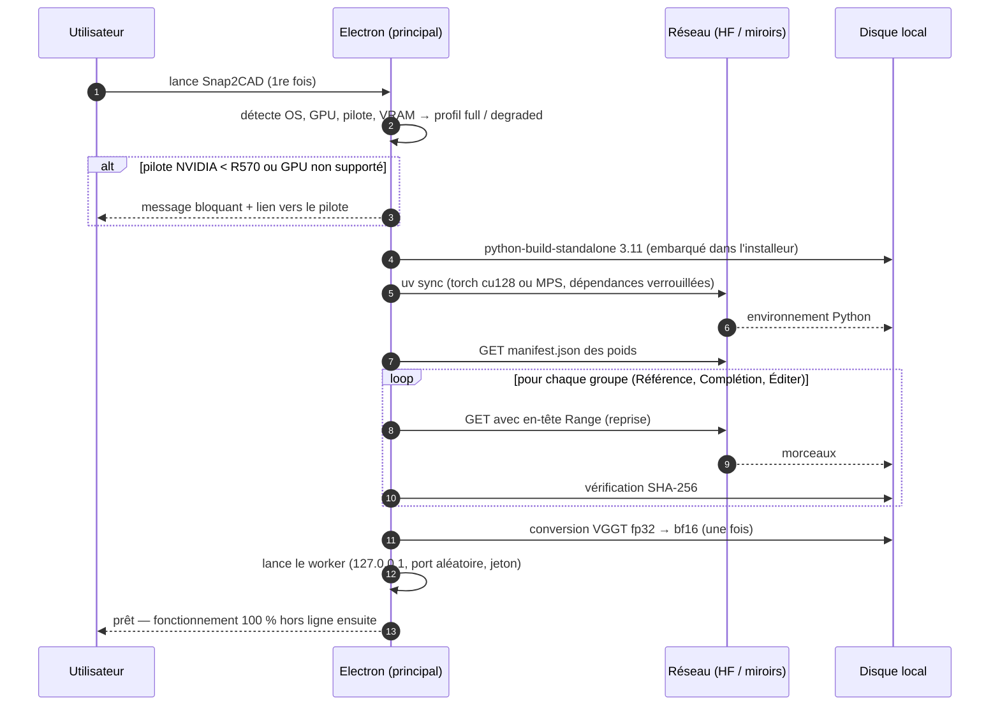

# Annexes du plan de développement

Retour au plan : [PLAN_DE_DEVELOPPEMENT.md](../../PLAN_DE_DEVELOPPEMENT.md)

- **A1 et A2** sont des images SVG.
- **A3 à A9** sont des diagrammes Mermaid. Ils s'affichent sur GitHub et GitLab, dans Obsidian, et dans VS Code avec l'extension *Markdown Preview Mermaid Support*.

---

## A1 — Architecture globale



- **Electron** ne fait aucun calcul : il affiche les fichiers produits par les étapes et envoie des commandes au worker.
- **Le worker** orchestre les étapes. Chaque étape tourne dans un sous-processus qui libère toute sa mémoire en se terminant.
- **Le dossier projet** est la seule source de vérité. On peut le copier, l'archiver ou le rejouer en ligne de commande.

---

## A2 — Pipeline du mode Référence (v2)



Différences avec le schéma initial (`Pipeline-photo-CAO.png`) :
- VGGT tourne sur les photos entières, le détourage vient après ;
- ajustement de faisceaux et échelle dans le tronc commun ;
- reconstruction dense et maillage ajoutés ;
- complétion reléguée au rang de repli, après le guidage pour reprendre des photos.

---

## A3 — Séquence d'exécution et VRAM

Une seule étape GPU à la fois. La mémoire est libérée par la fin du sous-processus, pas par un simple `del model`.



---

## A4 — Dossier projet et cache par hash

### Arborescence

```
mon_objet.s2c/
├── project.json            # état, paramètres, hash, versions (voir ci-dessous)
├── input/                  # photos d'origine (inchangées)
├── images/                 # photos normalisées (orientation EXIF appliquée)
├── exif.json
├── vggt/predictions.npz    # poses, intrinsèques, profondeur, confiance (sans échelle)
├── masks/
│   ├── object/*.png
│   └── reference/*.png
├── sparse/                 # COLMAP : cameras.bin, images.bin, points3D.bin
├── ba_report.json
├── scale.json              # facteur, σ, type de référence, repère monde
├── dense/fused.ply
├── coverage.json  coverage.ply
├── completion/             # (repli) mesh Hunyuan brut + transformation ICP
├── mesh.ply                # attributs : source, confidence, n_views, tri_angle_deg, sigma_mm, session
├── preview.glb
├── measurements.json
├── exports/                # STL, OBJ, PLY, GLB, STEP
├── report.json
└── logs/<étape>.jsonl
```

### Exemple de `project.json`

```json
{
  "schema_version": 1,
  "app_version": "0.1.0",
  "mode": "reference",
  "units": "mm",
  "world_frame": "table_z_up",
  "reference_object": { "type": "coin_2eur", "diameter_mm": 25.75, "thickness_mm": 2.20 },
  "options": { "underside": "not_covered", "profile": "full", "device": "cuda:0" },
  "sessions": [ { "id": 0, "input_dir": "input/", "n_images": 28 } ],
  "steps": {
    "poses_init": {
      "status": "done",
      "params": { "model": "vggt-1b", "dtype": "bf16", "resolution": 518 },
      "model_sha256": "…",
      "code_version": "snap2cad 0.1.0 + vggt@a288dd0",
      "inputs_hash": "sha256:…",
      "outputs": { "vggt/predictions.npz": "sha256:…" },
      "duration_s": 41.2,
      "peak_vram_mb": 5310
    },
    "scale": {
      "status": "done",
      "params": { "method": "ellipse_multiview", "min_views": 5 },
      "inputs_hash": "sha256:…",
      "outputs": { "scale.json": "sha256:…" },
      "result": { "scale": 87.31, "sigma_rel": 0.0011, "n_views": 9 }
    },
    "dense": { "status": "stale", "reason": "inputs_hash changed (masks/object)" }
  }
}
```

### Décision de relance



---

## A5 — Chaîne d'échelle et d'incertitude



---

## A6 — Jalons et dépendances

Le chemin critique est en gras (bordure orange).



| Jalon | Taille (hypothèse) | Sortie vérifiable |
|---|---|---|
| M0 | M | `check_env` vert, tableau VRAM et temps, N₈ et N₆ fixés |
| M1 | M | Poses VGGT, erreur de rotation sur DTU et MobileBrick |
| M1b | M | 10 objets × 3 variantes avec vérité terrain |
| M2 | M | IoU des masques ≥ 0,9 (synthétique) |
| M3 | M | Reprojection < 1 px, rotation meilleure que M1 |
| M4 | M | Erreur d'échelle < 0,15 % (pièce) et < 0,08 % (carte) |
| M5 | L | Cotes P90 ≤ 0,5 mm (synthétique), F-score MobileBrick |
| M6 | M | Rappel des zones manquantes ≥ 95 % |
| M7 | M | 68 % ± 10 % dans 1σ ; cotes recalées ≤ 0,2 mm |
| M8 | L | Démo de bout en bout sans ligne de commande |
| M9 | M | Fusion des séries retournées, ambiguïté détectée |
| M10 | M | Aucun sommet « généré » utilisable pour une cote |
| M11 | L | Installation vierge et projet hors ligne sur chaque OS |

---

## A7 — Plan de validation



**État des téléchargements (11/11/2026) :**

| Dataset | Archive | Taille | Extrait dans |
|---|---|---|---|
| DTU MVS 2014 SampleSet | `SampleSet.zip` (roboimagedata2.compute.dtu.dk) | 6,9 Go | `datasets/dtu/` |
| MobileBrick (split test uniquement, 18 séquences) | `MobileBrick_Mar23.zip` (robots.ox.ac.uk) | 13,1 Go (test : 2,0 Go) | `datasets/mobilebrick/test/` |

Contenu vérifié :
- **DTU :** scènes 1 et 6 avec images `Cleaned` et `Rectified` (49 positions × 7 éclairages), calibration, nuages de référence `Points/stl/stl00{1,6}_total.ply`, masques d'évaluation `ObsMask` et plans, résultats des méthodes de référence (camp, furu, tola), code d'évaluation MATLAB.
- **MobileBrick :** 18 séquences, 9 868 fichiers. Images 1920 × 1440, intrinsèques et poses par image (caméra → monde, **en mètres**), masques, profondeur de référence, `mesh/gt_mesh.ply`.

L'archive MobileBrick est en zip64 : `unzip` (MSYS) n'extrait rien sans signaler d'erreur. Utiliser `C:\Windows\System32\tar.exe -xf`.

Les archives d'origine sont conservées dans `datasets/_downloads/`. Elles peuvent être supprimées pour libérer environ 20 Go.

---

## A8 — Matrice des plateformes

| Composant | Windows 10/11 + NVIDIA | Ubuntu 22.04 / 24.04 + NVIDIA | macOS Apple Silicon |
|---|---|---|---|
| torch | 2.7 cu128 | 2.7 cu128 | 2.7 (MPS) |
| Pilote | ≥ R570 | ≥ R570 (paquet système) | — |
| VGGT | bf16 | bf16 | fp16 (à valider), float64 → processeur |
| SAM 2.1 | ✔ (extension CUDA ignorée) | ✔ | ✔ (MPS) |
| BiRefNet | ✔ | ✔ | ✔ |
| pycolmap (ajustement) | wheel (à vérifier) | wheel | wheel |
| Reconstruction dense | COLMAP CUDA (binaire officiel) | COLMAP CUDA (à compiler) | **OpenMVS** (CPU) |
| Open3D | ✔ | ✔ | ✔ |
| Hunyuan3D-2mv | fp16, FlashVDM | fp16, FlashVDM | MPS, lent (option) |
| CAD-Recode (phase 2) | sdpa | sdpa | MPS |
| CadQuery / OCP (phase 2) | wheel | wheel | wheel arm64 (à vérifier) |
| Paquet | NSIS (electron-builder) | AppImage | `.dmg` non signé |
| Intégration continue | GitHub Actions (CPU) | GitHub Actions (CPU) | GitHub Actions macOS arm64 (CPU) |
| Tests GPU | Manuels : 3060 Laptop et 4060 | Manuels (si machine dispo) | Manuels (si Mac dispo) |

---

## A9 — Premier lancement (installeur léger)


